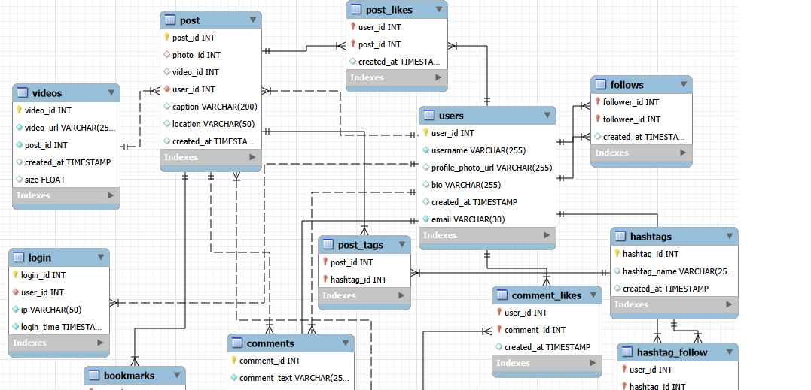

# Social Media SQL Analytics

A SQL-based data analysis project exploring user activity, content performance, engagement, and hashtag trends in a relational social media database.

The project uses **MySQL 8.0+** to analyze structured sample data through SQL queries, transforming raw records into descriptive insights about platform activity and user engagement.

## Project Overview

This project analyzes a sample social media database to explore how users interact with content and how engagement is distributed across users, posts, comments, and hashtags.

The analysis covers:
- User activity and posting behavior.
- Post likes, comments, and overall engagement.
- User popularity and follower distribution.
- Hashtag usage and engagement performance.
- Login activity and sequential time analysis.
- Additional business-oriented questions to explore content and user performance.

The repository contains the database creation and data insertion scripts, an ERD, and 28 organized SQL analysis queries.

## Dataset Overview

The database contains **13 relational tables and 5,142 records** in total.

| Table | Records | Description |
|---|---:|---|
| users | 50 | User information |
| photos | 50 | Photo records |
| videos | 50 | Video records |
| post | 100 | Published posts |
| comments | 199 | Comments on posts |
| post_likes | 1,707 | Likes on posts |
| comment_likes | 381 | Likes on comments |
| follows | 1,873 | User follow relationships |
| hashtags | 31 | Hashtag records |
| hashtag_follow | 30 | Hashtag follow relationships |
| post_tags | 377 | Post-hashtag associations |
| bookmarks | 194 | Bookmarked posts |
| login | 100 | Login records |
| **Total** | **5,142** | **13 tables** |

**Note:** The database contains sample/synthetic data. These results are intended for SQL practice and exploratory analysis, not as evidence of actual social media platform behavior.

## Database Structure & Relationships

The database follows a relational structure that organizes platform data into several connected areas:

- **Users:** Stores user records and supports the analysis of user activity and follower relationships.
- **Content:** Includes posts, photos, and videos.
- **Engagement:** Tracks post likes, comments, comment likes, and bookmarks.
- **Hashtags:** Stores hashtags and their associations with posts and users.
- **Activity:** Contains login records for examining user login sequences and time intervals.

Relationship and table structures are documented in the Entity Relationship Diagram (ERD).

### ERD



The repository also includes the editable MySQL Workbench model:

`documentation/Social_Media_ERD.mwb`

## SQL Analysis

The project includes **28 SQL queries**, organized into two main sections.

### 1. Core SQL Analysis (Queries 01–18)

Explores the main database entities and their relationships, including:
- User and content statistics.
- Post and comment engagement.
- Likes and bookmarks.
- Hashtag usage and popularity.
- User activity and login patterns.

### 2. Additional Business-Oriented Analysis (Queries 19–28)

Extends the analysis through questions related to:
- User performance and average engagement.
- Content performance and interaction metrics.
- Ranking users and posts.
- Comparing engagement across hashtags.
- Analyzing login sequences and time intervals.

## Key Findings

The following findings are based on the sample dataset and the results of the SQL queries.

### Platform Activity

- **50 users** and **100 posts** were recorded.
- The database contains **199 comments** and **1,707 post likes**.
- The average number of posts per user is **2.00**.
- Five users had no published posts in the dataset.

### User Performance

- Ethan received the highest total number of likes across his posts, with **107 likes**.
- Liam ranked second with **92 likes**.
- Charlie had the highest follower count, with **45 followers**.
- The average number of likes received per user was **34.14**, including users with no posts.

### Content Engagement

- **Post 42**, published by Liam, received the highest number of post likes, with **24 likes**.
- It also recorded **28 total interactions**, combining 24 likes and 4 comments.
- Archie, Harris, and Harrison recorded the highest average post likes, at **21 likes per post** each. However, each had only one post, so this result should be interpreted in the context of their limited posting volume.

### Hashtag Analysis

- `#beautiful` was the most frequently used hashtag, appearing in **21 posts**.
- `#festivesale` and `#socialmedia` followed with **19 posts** each.
- `#festivesale` had the highest number of hashtag followers, with **4 followers**.
- `#runforunity` recorded the highest average engagement per post among the analyzed hashtags, at approximately **20.83 interactions** across 12 posts.

Engagement here refers to the combined number of post likes and comments.

## SQL Techniques & Concepts

The project demonstrates practical use of SQL techniques, including:

- `SELECT`, `WHERE`, `ORDER BY`, and `GROUP BY`
- Aggregate functions: `COUNT()`, `SUM()`, and `AVG()`
- `INNER JOIN` and `LEFT JOIN`
- Subqueries and Common Table Expressions (CTEs)
- Window functions:
  - `ROW_NUMBER()`
  - `RANK()`
  - `LAG()`
  - `LEAD()`
- Conditional and null-handling functions:
  - `COALESCE()`
  - `NOT EXISTS()`
- Date and time calculations using `TIMESTAMPDIFF()`

These techniques support multi-table analysis, ranking, aggregation, and sequential activity analysis.

## Repository Structure

```text
Social-Media-SQL-Analytics/
│
├── database/
│   ├── CreateTables.sql
│   └── InsertData.sql
│
├── documentation/
│   ├── ERD.png
│   ├── Social_Media_ERD.mwb
│   └── insights.md
│
├── queries/
│   └── Social_Media_Queries.sql
│
└── README.md
```

## How to Run the Project

### Requirements

- MySQL Server 8.0 or later.
- MySQL Workbench or another MySQL-compatible SQL client.

### Setup

1. Clone or download this repository:

   ```bash
   git clone https://github.com/aishamohamadi/social-media-sql-analytics.git
   ```

2. Open MySQL Workbench and connect to your MySQL server.

3. Open and execute `database/CreateTables.sql` to create the database tables.

4. Execute `database/InsertData.sql` to populate the tables with sample data.

5. Open `queries/Social_Media_Queries.sql`.

6. Execute the queries to explore the database and reproduce the analysis.

Make sure the `social_media` database is selected before running the analysis queries.

## Data Quality & Limitations

A few considerations are important when interpreting the results:

- **Synthetic data:** The database contains sample records and does not represent real users or actual platform activity.
- **Limited dataset size:** The analysis covers 50 users and 100 posts, so findings should not be generalized to larger platforms.
- **Hashtag inconsistencies:** The dataset contains duplicate hashtag names under different IDs, including `#followme`. These records should not be treated as one entity without an explicit data-cleaning rule.
- **Formatting inconsistencies:** Some hashtag names and text fields contain differences in capitalization, spacing, or formatting.
- **Login timestamps:** Some login records have very short time intervals, including zero- or one-second gaps. Therefore, login timing results should be interpreted cautiously and not treated as reliable evidence of actual user behavior.
- **Descriptive analysis:** The project identifies patterns within the available records; it does not establish causal relationships or predict future behavior.

## Project Documentation

- [SQL Analysis Queries](queries/Social_Media_Queries.sql)
- [Analysis Insights](documentation/insights.md)
- [Database ERD](documentation/ERD.png)
- Editable ERD: `documentation/Social_Media_ERD.mwb`

## Conclusion

This project demonstrates how relational databases and SQL can be used to explore structured social media data, analyze engagement patterns, compare user and content performance, and communicate findings through clear analytical questions.

It provided practical experience in database querying, multi-table analysis, aggregation, ranking, and data interpretation using MySQL.